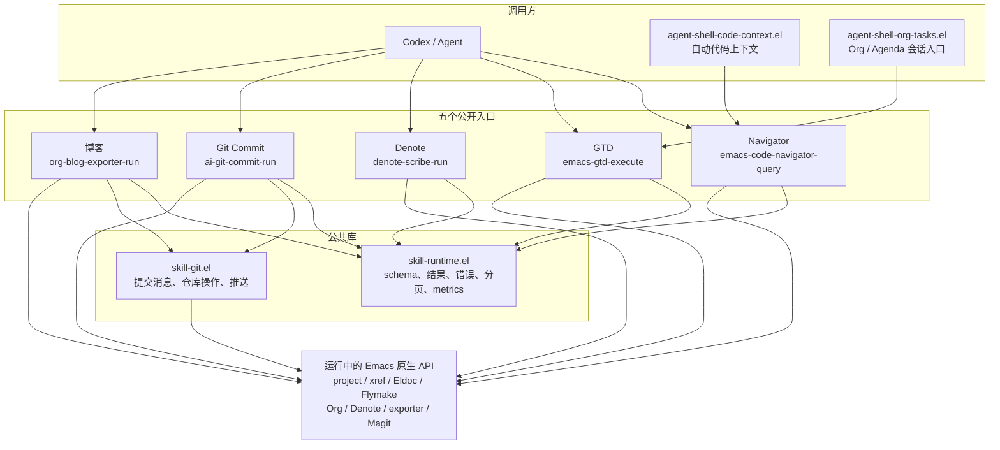

# AI Skills

一组面向 AI 助手的本地 skills。它们把可靠性约束、运行中的 Emacs 状态，以及
Denote、Org GTD、Org 导出和 Magit 等能力封装成可验证的工作流。

## Skills

| Skill | 功能 | 典型请求 |
| --- | --- | --- |
| [`denote-scribe`](denote-scribe/SKILL.md) | 将确认的技术讨论保存为 Denote 笔记，支持按明确要求关联 Org 任务。 | “输出 Denote 报告” |
| [`emacs-code-navigator`](emacs-code-navigator/SKILL.md) | 将运行中的 Emacs 作为能力注册表和代码上下文来源：区分 live buffer 与磁盘内容并报告来源和分歧，同时支持 Help、项目搜索、Imenu、xref、Eldoc/Eglot 和 Flymake。 | “Emacs 里有什么函数能完成这个任务？”“查看这个符号的文档和源码” |
| [`emacs-gtd-assistant`](emacs-gtd-assistant/SKILL.md) | 从 Org/Agenda 任务进入 AI 会话，关联项目文档、实施子任务和接续进度；也支持常规任务管理。 | “列出今天的任务”“把这个任务标记为 DONE” |
| [`org-blog-exporter`](org-blog-exporter/SKILL.md) | 将 `~/Dropbox/notes` 中符合条件的 Org 笔记导出为静态 HTML；支持单篇、批量和全量导出。明确要求发布时，还可更新索引、复制并重写本地资源、提交并推送博客仓库。 | “预览这篇 Org 笔记”“发布博客” |
| [`git-commit`](git-commit/SKILL.md) | 为任意仓库生成便于 AI 和人理解的提交信息；读取含未跟踪文件的实际 diff，按风险选择详细度，并可暂存和提交明确的文件集合。 | “生成 commit message”“提交这些修改” |

每个目录中的 `SKILL.md` 只保留触发条件、需要模型判断的规则和授权边界；可确定执行的
流程由 `scripts/*.el` 的公共函数、docstring 与校验错误构成。正常使用时无需让助手通读
实现源码。

> **架构原则：SKILL.md 不是 facade 的使用手册，也不是错误目录。它只保存无法在 Elisp 中可靠编码的语义决策。**

Elisp 实现优先复用 Emacs 及相关包的原生 API，按当前会话中的文档和源码核对行为。
仅补充原生能力缺失的业务逻辑，不重复实现已有的查找、解析和状态管理。

self-loading 入口通过 `common/scripts/skill-loader.el` 重新加载同一目录树中的共享源码，
并检查所需 API 版本，避免持久 Emacs 会话静默沿用旧校验或旧 Git 行为。缺失或过旧的
共享 API 会在入口加载阶段明确报错；重载保留用户选项、缓冲区和会话恢复 token。
共享层契约变更时需同步维护 API 标记与调用方最低版本；envelope 和 metrics 版本独立管理。

每个 Emacs 集成 skill 提供一个 compact 主入口：Navigator 限制 Help 长度，GTD 和博客
限制列表结果，Git Commit 限制 diff 总量，Denote 分页返回笔记列表。AI 调用只使用
各 skill 的统一主入口，完整上下文仅在 compact 结果不足时按需请求。

## 当前架构

下图展示主要执行依赖。五个 facade 共用 runtime；Git Commit 和博客还共用 Git
辅助库。self-loading 的源码加载与版本检查由前述 loader 负责。



GTD 的全部操作 schema 和分发集中在 `emacs-gtd-assistant.el`；
`emacs-gtd-project.el` 只提供项目和会话记录的实现，不在加载时修改操作表。
Git context 的共同字段统一组装；博客的完整与分页模式共用一个结果封装函数。
Denote 与 GTD 的关联由 Agent 按用户要求分别调用入口完成。

代码上下文 adapter 仍由 `emacs-code-navigator` 负责：读取 live buffer、光标、未保存状态、
project、scope、Eglot/Eldoc、少量 xref 定义和已有 Flymake 诊断。它直接接入
`agent-shell-context-sources`，保持 `region`、`error` 的优先级，执行 1,800 字符上限，
并且不会为了收集上下文启动 Flymake。

用户在 agent-shell 对话中要求审阅、生成提交信息或提交时，Agent 直接触发 `git-commit`，
从 Git/Magit 重新获取状态和 diff，并在已知文件范围时传入明确的 `:paths`。不同仓库不会
合并提交，也不会因为修改过文件而自动触发审阅或提交。限定路径的 context 只返回这些路径
的状态和内容；无关变更只报告数量，不暴露文件名。

用户在 Org/Agenda 项目或任务上沿用 `C-z a`，先选 AI，再选该 AI 在此项目的会话。
`agent-shell-org-tasks.el` 按明确的 PROJECT_DIR 识别项目，普通待办保留原生行为；
任务 ID 独立于项目路径与会话 ID。先讨论形成项目需求、
架构文档，再按用户指令通过 `add-children` 写入实施子任务；Org 条目本身承担实施计划，
项目 RESOURCES 链接到仓库和文档。收尾时通过 facade 的 `add-note` 和 `set-context`
更新日志与接续点，不因 AI 回合结束自动标记 DONE。新会话资料集中保存到
`~/Dropbox/.agent-shell/`；该目录不替代 agent 后端的原生会话存储。设置与操作见
[工作流说明](emacs-gtd-assistant/references/workflow.org)。

用户在 agent-shell 对话中要求记录当前讨论时，Agent 触发 `denote-scribe`，生成
按批判性思维要求组织、结构随内容选择的笔记提案，确认后创建 Denote，不主动建议 GTD 任务。
明确要求新建任务时使用 `emacs-gtd-assistant`；要求关联笔记时添加资源链接及所需回链。
跨文件操作若部分失败，报告已完成部分并提供修复。该流程不会自动 commit 或 push。

提交信息中的 `validation` 仍是 AI 必须提供的内部证据，用于判断声明是否可靠；`git-commit`
默认不把测试命令、通过数量等 validation 内容写入 commit body，而是在操作完成后向用户
报告。commit body 默认聚焦修改内容、原因和必要边界。

v2 主入口 envelope 统一返回 `:protocol-version`、`:status`、`:operation`、`:count` 和
`:data`；分页结果增加 `:page`，副作用增加 `:effects`。状态使用 `ok`、`partial`、
`needs-input`、`blocked` 或 `failed`。可预期的公共失败还返回 `:error`，至少包含稳定
`:code`、可读 `:message`、`:retry` 和 `:required-action`，并可附带字段路径、目标、
候选项或分页后的失败原因。部分成功保留已完成的 `:data` 与真实 `:effects`，同时用
`partial-failure` 指明未完成部分，是否可重试由 `:error :retry` 决定。
若领域操作失败时已观察到文件、缓冲区或仓库变更，则返回 `partial`、原始
`:cause` 和实际产物，要求先检查，避免盲目重试；未知错误在没有这些变更时继续抛出。
可选的顶层 `:verification` 按 artifact、workflow、repository 或领域判断分组
返回已完成检查及其证据；`:effects` 仍只描述实际发生的副作用。
校验器以原生 `user-error` 或明确的 `invalid-request` 拒绝输入；内部实现异常不转成
输入错误。批量导出仅逐项收集文件操作失败，未预期的实现异常直接停止。

每次成功或结构化失败调用都返回不保留原文的 `:metrics`，包括耗时、请求字符数、请求
字段数、payload 字符数、基础响应字符数、结果数、截断、降级和来源，并用版本号保护
历史比较。字符数是可重复的本地代理，不冒充模型服务的精确 Token usage。截断和下一页
位置均为机器可读字段。仅在调用参数不明确时请求 `describe` schema，无需读取实现源码。
指定 `:target` 的描述还返回 `:request-template`，包含必填字段和每组候选的第一个字段。
调用前须按 schema 替换所有 `<字段>` 占位值，并按实际上下文选择候选；模板不提供真实
目标，也不会自动填入发布或修改授权。

公共操作 schema 拒绝未知字段；拼错参数会返回字段位置和允许字段，不会静默忽略。
请求及嵌套任务 plist 同时拒绝重复字段，避免授权和目标选择依赖字段出现顺序；分页参数
和布尔开关按 schema 校验，输入错误返回结构化的 `invalid-request`。
`:required` 要求非空值；`:required-present` 要求显式提供键，并允许 `nil`，用于清空集合。
`skill-runtime-summarize-metrics` 可汇总一次流程的全部 facade 调用，包括失败、分页和
重试；它不保留原文，也不把 payload 和基础响应字符数重复相加。

## 主要工作流

### Denote 笔记

`denote-scribe` 通过 Denote 创建笔记，支持中文与英文的推理笔记。
项目专属的需求、架构保留在项目仓库；实施步骤与接续进度保留在 Org 项目和任务中。
Denote 用于值得长期保存的研究和排障推理。

默认笔记目录为 `~/Dropbox/notes/`。保存笔记不触发回顾、提交或推送；
明确要求提交时使用 `git-commit`。

### Org 博客导出与发布

`org-blog-exporter` 会跳过草稿、私有目录及带 `draft`、`private` 或
`noexport` 标签的笔记。导出时可使用 `setupfile.org` 配置 HTML；发布时还会：

- 更新博客索引；
- 将 Org 中引用的图片、音视频、PDF 等本地资源复制到仓库的 `image/` 目录，并重写导出副本中的链接；
- 仅提交本次生成的 HTML、索引和资源，然后推送配置的仓库。

Denote、博客发布和普通仓库提交共享同一套结构化证据、自然正文和 100 列 formatter；
低风险小改动自动压缩正文，高风险或多项修改保留完整边界。

导出不会隐式发布。只有用户明确要求“发布”时，skill 才能执行 clone、commit 和
push 流程。

博客发布中断时返回已完成 effects；可恢复的失败还返回 `:error :recovery-token`。
使用 `resume` 操作和该 token 继续，仍需显式发布授权。恢复会校验源文件、生成文件
内容、HEAD、分支、仓库配置和无关工作区变化；已完成的导出与提交不会重复执行。
token 仅在当前 Emacs 会话有效，最多保留最近 16 个，开始恢复后失效；可恢复的再次
失败会返回新的 token。

## Requirements

通用的 Emacs 集成要求：

- `emacsclient` 位于 `PATH`，且已有运行中的 Emacs server；
- 对应 Emacs 功能在该 session 中可用。

额外依赖如下：

- `denote-scribe`：Denote；
- `emacs-code-navigator`：Emacs 的 `project`、`xref`、Imenu；Eglot 和 Flymake 为按需能力；
- `emacs-gtd-assistant`：Org mode 和已有的 GTD 文件及目标 heading；
- `org-blog-exporter`：Org HTML exporter；发布流程还需要 Magit、Git 仓库和远端权限；
- `git-commit`：Magit（用于从任意当前仓库收集提交证据）；
- agent-shell 自动上下文：agent-shell 支持 `agent-shell-context-sources`；

## Install

将需要的 skill 目录复制或软链接到客户端使用的 skills 目录。仓库结构需要保留；
所有 Emacs skill 都会从同级 `common/` 加载统一返回协议；提交相关 skill 还会加载共享
Git formatter，因此安装任意 Emacs skill 时必须保留 `common/`。

例如，为 Codex 安装整个仓库时，可让目标目录包含：

```text
skills/
├── common/
├── denote-scribe/
├── emacs-code-navigator/
├── emacs-gtd-assistant/
├── org-blog-exporter/
└── git-commit/
```

如果客户端支持导入压缩包，可按需打包。下面的示例包含全部 skills：

```bash
zip -r ai-skills.zip \
  common denote-scribe emacs-code-navigator \
  emacs-gtd-assistant org-blog-exporter git-commit
```

启用或重新加载 skills 后，直接用自然语言提出表格中的请求即可。涉及删除、归档、
发布、提交或推送的操作仍受各 skill 的授权和安全检查约束。

开发修改后可运行统一契约测试：

```bash
emacs -Q --batch -l tests/run-tests.el
emacs -Q --batch -l tests/run-tests.el emacs-gtd-assistant-tests.el
```

不带 suite 参数时运行全部测试；传入一个或多个 suite 文件名时，只加载对应领域实现，
便于隔离定位失败。测试入口会初始化已安装的 Emacs packages；需要 Magit 或 Git 的 suite
会显式检查依赖，使真实的路径限定 context 测试不会在 `-Q` 环境中静默跳过。

`tests/routing-cases.el` 保存 skill 路由的正反案例，供人工评审或另行固定模型版本的评测
使用。常规 ERT 只校验案例结构、skill 名称和边界完整性，不用关键词匹配冒充模型路由结果。
依赖前文的案例附带合成的会话历史，恢复案例还包含工具结果，可通过
`tests/routing-evaluation.el` 导出不含预期答案的消息。部分案例还约束 token、路径范围
和 live 来源等关键参数。独立评测分别记录路由、调用、完成判断和授权边界，并比较整段流程成本；
输入、记录模板及隔离要求见[评测说明](tests/routing-evaluation.org)。

`emacs --batch -l tests/run-workflows.el` 单独运行三条隔离的原生流程，输出经过验证的
检查项与真实 facade 成本：GTD 查询到授权修改、限定路径的 Git context、博客推送失败
后的恢复。它们使用临时文件与本地 Git remote，不代表固定模型版本的路由评测结果。

在 Emacs 配置中启用公共代码上下文：

```elisp
(load "/path/to/skills/emacs-code-navigator/scripts/agent-shell-code-context.el")
(emacs-code-navigator-agent-shell-enable)
```

Git Review、Denote、独立 GTD 捕获都不注册回合动作；用户在 agent-shell
对话中表达相应意图后，由 Agent 依据 skill 元数据直接触发并执行。
